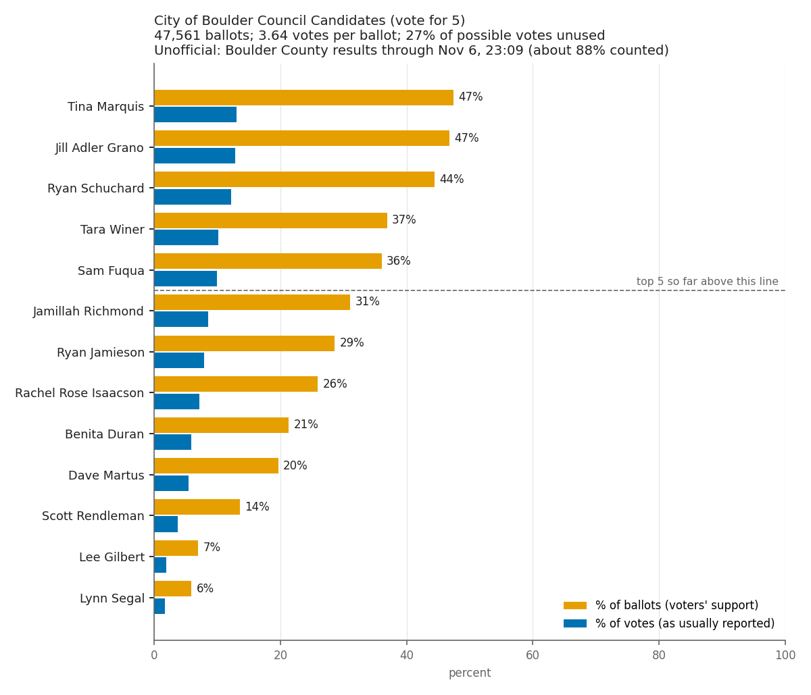
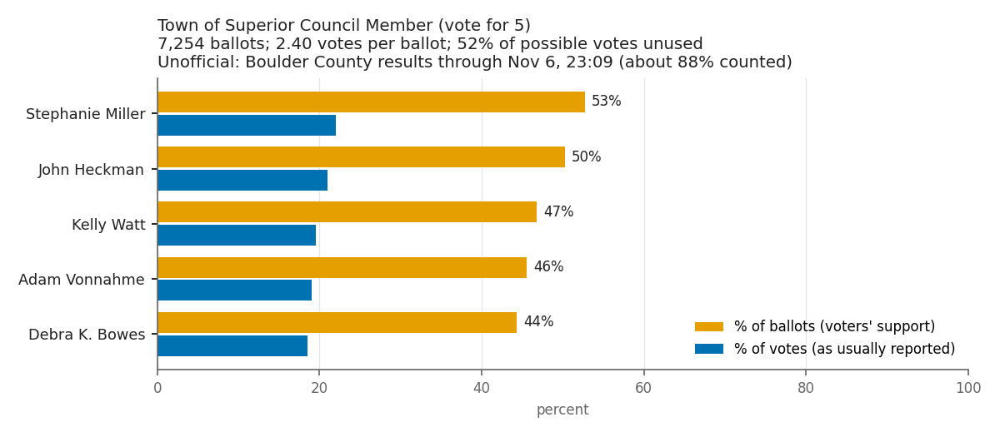
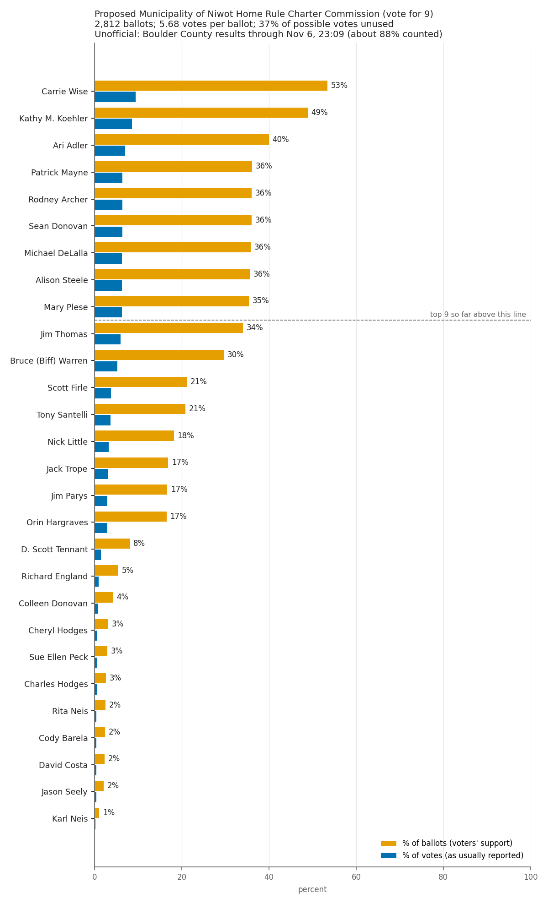
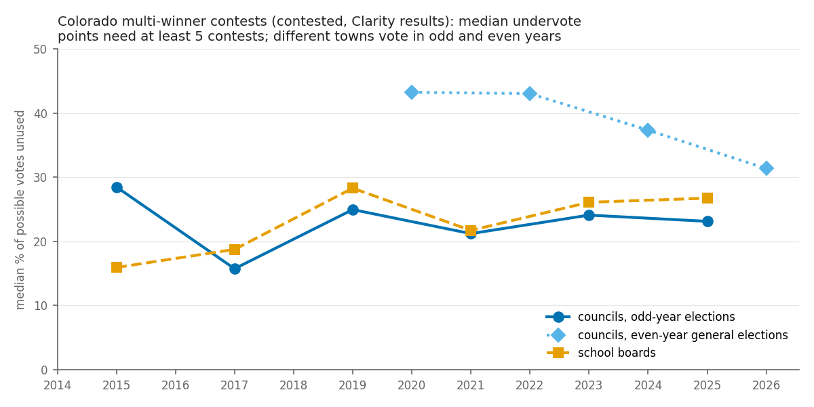
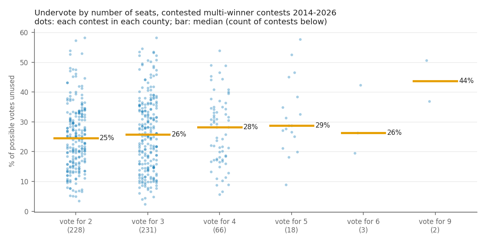

# Election reporting: account for every ballot, and show what voters actually chose

**Draft for discussion** by the Voting Methods Team of the League of Women Voters of Boulder County
(LWVBC), November 8, 2026. This builds on the team's earlier work on election reporting, including
the 2021 [Boulder Beat article](https://boulderbeat.news/2021/10/20/lwv-election-reporting/) and
the "A Better Way to Report Election Results" articles (see [Earlier work](#earlier-work-by-the-team)). **The 2026 figures are unofficial**: counties are still counting, and
the last ballots include rare ballot styles held back so no update reveals one voter's choices,
plus signature cures, late-arriving and provisional ballots.

Election results reporting should serve two goals:

1. **Account for every ballot.** For each contest, the published numbers should show what
   happened on every ballot that carried it: votes, undervotes, overvotes and, for ranked-choice
   contests, exhausted ballots and ranking errors, adding up to the number of ballots. This is an
   election integrity check that anyone can run, and it exposes ballot design problems.
2. **Give an accurate view of the electorate.** Where voters may choose more than one candidate
   (multi-winner bloc plurality, approval voting), "percent of votes" badly understates how many
   voters supported each candidate. Dividing by the number of **ballots** shows the share of
   voters who chose each candidate.

The data to do both is now published in most of Colorado, on election night, in the files behind
the state's results site. The main gap is presentation, and a few counties, Boulder among them,
that leave the undervote and overvote columns empty.

## Part 1: Account for every ballot

### The ballot accounting identity

For a contest where each voter may choose up to *N* candidates:

> votes + undervotes + overvotes × *N* = ballots × *N*

An **undervote** is an unused choice (a blank contest counts *N*); an **overvote** is a ballot
that marked too many, so none of its choices in that contest count. When the published numbers
satisfy this identity, every ballot is accounted for. When they don't, something needs
explaining: a ballot count covering a different area than the contest, a reporting error, or a
tabulation problem.

### Most Colorado counties already publish balanced numbers

Colorado's results site (run on Clarity Elections) offers a downloadable summary report for each
county with columns for "ballots cast", "under votes" and "over votes" for every contest. Checking
every county's file for each election:

| Election | Counties reporting undervotes | Contest rows that balance exactly* |
|---|---|---|
| 2017–2019 | 0–2 of 57–63 | — |
| 2020 general | 31 of 63 | — |
| 2022 general | 60 of 63 | 664 of 2,656 (many use a county-wide ballot count) |
| 2023 coordinated | 59 of 64 | 722 of 902 (80%) |
| 2024 general | 60 of 64 | 2,163 of 2,410 (90%) |
| 2025 coordinated | 57 of 63 | 821 of 838 (98%) |
| 2026 general (unofficial) | 56 of 64 | 2,394 of 2,592 (92%) |

\* Among counties that report undervotes; most of the rest are within 1%.

So publishing a full ballot accounting for every contest is routine practice, not a burden. The
counties that leave "under votes" at 0 in every recent election include **Boulder**, Douglas,
Garfield and San Juan (Boulder's files for 2023, 2024 and 2026 all show 0).

### Why it matters

- **Ballot design.** Unusual undervote rates are the classic sign of a contest voters missed or
  misunderstood. In Broward County, Florida, in 2018, a U.S. Senate contest placed under a column
  of instructions was skipped by 4.5% of voters there, against 0.7% in the rest of Florida,
  plausibly enough to change the statewide result. Routine undervote reporting makes such
  problems visible while they can still be investigated.
- **Catching errors in interim results.** Archiving Colorado's election-night uploads every few
  minutes in 2026, our checks flagged 128 interim county updates whose numbers could not all be
  right: mostly contests with more votes than their reported ballots allow, and some where the
  count of precincts reporting reset to zero. Most have innocent explanations, but only a full
  accounting lets the public tell.
- **Single-winner contests too.** Dividing by votes hides voters who skip a contest. In Erie's
  2026 District 1 council race 16% of the ballots carrying it had no vote; in Superior's
  uncontested 2026 mayor race, 29%; in Longmont's mayor race, about 7% in 2023 and 6% in 2025.

### Ranked-choice contests need more

Ranked-choice (instant-runoff) contests have more ways for a ballot to be partly or wholly
uncounted, and they are often reported only as round-by-round totals. Boulder's ranked-choice
mayor contest does not appear in the state's Clarity results at all. A complete report would
give, for each contest:

- ballots carrying the contest, and ballots with **no ranking** (undervotes);
- ballots with an **overvote** at some rank (two candidates at one rank), and how the rules
  treated them;
- ballots with **skipped** or **duplicate** rankings;
- **exhausted ballots in each round**, split by cause: all ranked candidates eliminated
  (including ballots that ranked fewer candidates than allowed), overvote reached, or too many
  skipped rankings;
- the winner's final-round total as a share of **all ballots** carrying the contest, as well as
  of continuing ballots;
- the anonymized cast vote records, so the tabulation can be independently reproduced.

### Ballots, not just votes

The same principle applies before any contest is counted: ballots issued, returned, accepted,
rejected, cured and still to count, by county and update. Colorado's Secretary of State already
publishes much of this; linking it to the results makes "how many ballots are left?" answerable
on election night.

## Part 2: Show what voters actually chose

### Percent of votes versus percent of ballots

In a vote-for-5 council race, a candidate's **percent of votes** is bounded near 20% even if
every voter chose them. **Percent of ballots** (votes for the candidate ÷ ballots carrying the
contest) is the share of voters who chose that candidate, and can reach 100%. The same holds for
approval voting, where percent of ballots is simply each candidate's approval rate, and for any
method allowing several marks.

Two figures summarize each multi-winner contest:

- **Average votes per ballot:** votes ÷ ballots (at most *N*).
- **Average undervote:** 1 − votes ÷ (ballots × *N*), the share of possible votes left unused.

### Boulder County, 2026 (unofficial, through 11:09 PM Nov 6, about 88% counted)

| Contest | Seats | Candidates | Ballots | Votes per ballot | Undervote |
|---|---|---|---|---|---|
| Niwot Home Rule Charter Commission | 9 | 28 | 2,812 | 5.68 | 37% |
| City of Boulder Council | 5 | 13 | 47,561 | 3.64 | 27% |
| Town of Superior Council | 5 | 5 | 7,254 | 2.40 | 52% |

- **City of Boulder:** the three leaders were each chosen by 44–47% of voters but appear as
  12–13% of the votes on the county's results page.
- **Superior:** all five candidates win seats, but only the top three get 4-year terms. Voters
  used fewer than half their possible votes, and each candidate was chosen by 44–53% of voters
  while showing as 18–22% of the votes.
- **Niwot:** the ninth and tenth places, 35.4% and 34.0% of voters, are 38 votes apart.

Boulder over time (City of Boulder Council): 28% of possible votes unused in 2015, then 18%, 19%,
20%, 17% and 17% (2017–2025), and 27% in 2026 with a fifth seat on the ballot: voters chose
about the same number of candidates (3.3–3.6) with more seats to fill.

### Statewide, 2014–2026

Every Colorado county's final Clarity results since 2014 include **904 multi-winner contests in
60 counties** (each county's part of a district counted separately). For the 712 with a
trustworthy ballot count:

- **The last winner is usually chosen by fewer than half the voters.** In the median contested
  race, the candidate taking the last seat was chosen by **44% of ballots** but shows as **23% of
  votes**. In 72% of contested races the last winner was on fewer than half the ballots.
- **About a quarter of possible votes go unused** in contested races (median 25%), and about half
  in uncontested ones (48%).
- Undervotes rise a little with the number of seats (vote for 2: 25%; vote for 5: 29%) and fall
  with competition (29% with up to 1.5 candidates per seat, 18–19% with two or more).
- Council races in even-year general elections, mostly smaller towns at the end of a long ballot,
  run much higher (medians 32–43%) than odd-year council races (about 23%).

For ranked-choice contests, the analogous correction is to report the winner's final-round share
of **all ballots**, alongside the share of ballots still continuing in the final round.

## Is the data available?

Yes, mostly, and on election night:

- Clarity's per-county summary report has had a per-contest "ballots cast" column since at least
  2014, but its quality varies: often missing (0) in 2015 and always in 2019, often a county-wide
  total in 2021, and contest-specific in most counties since 2022. Boulder's 2024 and 2026 files
  are contest-specific, in 2026 from the first election-night upload.
- The results web page's own per-contest ballot figure is published for every county in every
  election, including Boulder's, but overcounts districts that split precincts.
- Boulder County has results on Clarity for every election since 2014; in 2015, 2017–2021, the
  2022 general and 2025, only the web page's data, not the downloadable summary report.

## Recommendations

To the Boulder County Clerk, and to Colorado counties generally:

1. **Report undervotes and overvotes for every contest**, from the first results, as most
   Colorado counties already do, so that the numbers for each contest add up to its ballots.
2. **Report each candidate's percent of ballots** alongside percent of votes, for every
   multi-winner contest.
3. **Publish per-contest ballot counts** on the county's own results page, and keep them
   contest-specific (not county totals).
4. **For ranked-choice contests**, publish round-by-round results with exhausted ballots by cause,
   ranking errors, final-round shares of all ballots, and the cast vote records, in the same
   place as other results.

To the Secretary of State: make the ballot accounting identity a standard check on every county
upload, and publish the per-contest summary report for every county in every election.

## Earlier work by the team

Published articles, letters and interviews on election results reporting, oldest first. Copies
of items not otherwise online are in [`docs/`](docs/).

- **2019 results chart** (prepared November 2020): City of Boulder Council 2019 (vote for 6) as
  percent of votes and percent of ballots.
  [PDF](docs/2019-boulder-city-council-percent-of-ballots-chart.pdf)
- **Letter to Boulder County Clerk Molly Fitzpatrick**, December 11, 2020: asks that multi-winner
  council results also be reported as each candidate's percent of ballots, illustrated with the
  2019 chart.
- **"Possible Changes to City Council Elections in Colorado: Lafayette and Boulder – A Different
  Way to Report Election Results"**, Celeste Landry,
  [LWVBC *Voter*, February 2021](https://lwvbc.clubexpress.com/content.aspx?page_id=5&club_id=629866&item_id=61316).
- **"Guest opinion: A better way to report election results"**, Mark Parsons and Neal McBurnett,
  [Boulder Beat, October 20, 2021](https://boulderbeat.news/2021/10/20/lwv-election-reporting/).
- **"Another Look at Council Elections in Boulder County"**, Mark Parsons, LWVBC *Voter*,
  December 2021: 2021 Boulder, Lafayette and Longmont council results as percent of ballots.
  [PDF](docs/2021-12-voter-another-look-at-council-elections.pdf)
- **"The Way Most Places Report Election Results Is Pretty Misleading"**, Mark Parsons and Neal
  McBurnett interviewed by Alexis Kenyon,
  [KGNU Morning Magazine, December 10, 2021](https://kgnu.org/the-way-most-places-report-election-results-is-pretty-misleading/).
- **"A Better Way to Report Election Contest Results: Part 1 – Boulder County's Multi-Winner
  Contests"**, Celeste Landry, Mark Parsons and Neal McBurnett,
  [LWVBC *Voter*, December 2023](https://lwvbc.org/content.aspx?page_id=5&club_id=629866&item_id=95672&).
- **"November 2023 Local Elections Through the Lens of Voting Methods"**, Voting Methods Team,
  [LWVBC *Voter*, December 2023](https://lwvbc.clubexpress.com/content.aspx?page_id=5&club_id=629866&item_id=95671).
- **"Boulder is not as politically polarized as you might think, election data show"**, Boulder
  Reporting Lab, December 18, 2023, drawing in part on background on undervotes, overvotes and
  ranked-choice results from Neal McBurnett:
  [boulderreportinglab.org](https://boulderreportinglab.org/2023/12/18/boulder-is-not-as-politically-polarized-as-you-might-think-election-data-show/).
- **"Boulder can do better election reporting in mayoral contest"**, guest opinion, LWVBC
  (Celeste Landry and team), on reporting Boulder's first ranked-choice mayoral results,
  [Daily Camera, January 11, 2024](https://www.dailycamera.com/2024/01/11/guest-opinion-celeste-landry-boulder-can-do-better-election-reporting-in-mayoral-contest/)
  ([LWVBC copy](https://lwvbc.org/content.aspx?page_id=86&club_id=629866&item_id=47145)).
- **"A Better Way to Report Election Results: Part 2 – Single-Winner Contests and Election
  Integrity"**, Neal McBurnett and Celeste Landry, LWVBC *Voter*, March 2024: undervotes,
  overvotes, ballot design and ranked-choice exhausted ballots.
  [PDF](docs/2024-03-voter-better-way-part-2-single-winner-and-integrity.pdf)
- **"A Better Way to Report Multi-Winner Plurality Contest Results – 2025 Boulder County"**,
  Celeste Landry with graphs by Mark Parsons, LWVBC *Voter*, December 2025.
  [PDF](https://mcusercontent.com/60e8006477ddf87fb95c6293d/files/165af69d-9a0b-c7b7-d380-3414b8355a41/Final_2025_12_Voter_Better_MW_Plurality_Election_Reporting.docx.pdf)
  ([copy](docs/2025-12-voter-better-way-multi-winner-plurality-2025.pdf))
- **"Marsing, Prieto had more support than reports indicate"**, letter to the editor by Gaythia
  Weis, *Longmont Times-Call*, December 12, 2025: Longmont's at-large winners were chosen by about
  45% and 38% of voters, though reported as 29% and 25% of the votes.

**To do:** find online sources for the items listed here without one (the 2020 letter and the
Times-Call letter) and for those linked only as copies in `docs/` (the March 2024 and December
2021 *Voter* articles, in the League's newsletter archive, and the 2019 chart).

## Data and tools

- [`data/multiwinner_contests.csv`](data/multiwinner_contests.csv): every multi-winner contest-county 2014–2026, with ballots,
  votes, seats, votes per ballot, undervote, and a flag for how far the ballot count can be
  trusted (ok, ?, <= upper bound, >= lower bound, na). [`data/multiwinner_candidates.csv`](data/multiwinner_candidates.csv): each
  candidate's % votes and % ballots. [`data/boulder-county-2026-unofficial-summary.csv`](data/boulder-county-2026-unofficial-summary.csv): the 2026
  Boulder County table.
- The figures and tables were produced with open-source tools in
  [snapshot-election-results](https://github.com/nealmcb/snapshot-election-results), which archive Clarity results on election
  night and compute these measures. Reproducible records of each analysis, with pinned inputs,
  will be added here when results are final.

Corrections and suggestions are welcome: [open an issue](https://github.com/nealmcb/election-reporting/issues), or contact the LWVBC Voting Methods
Team.
